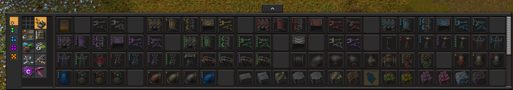
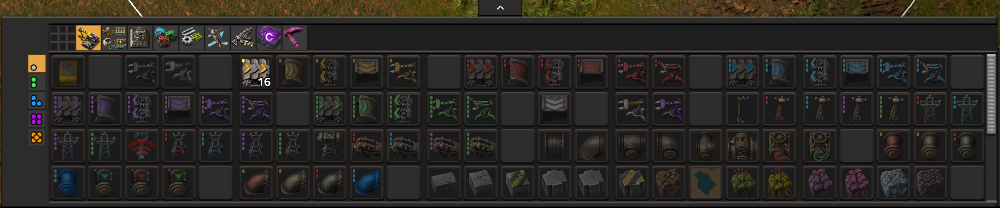
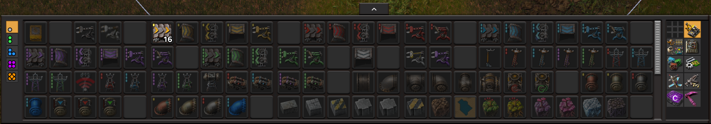
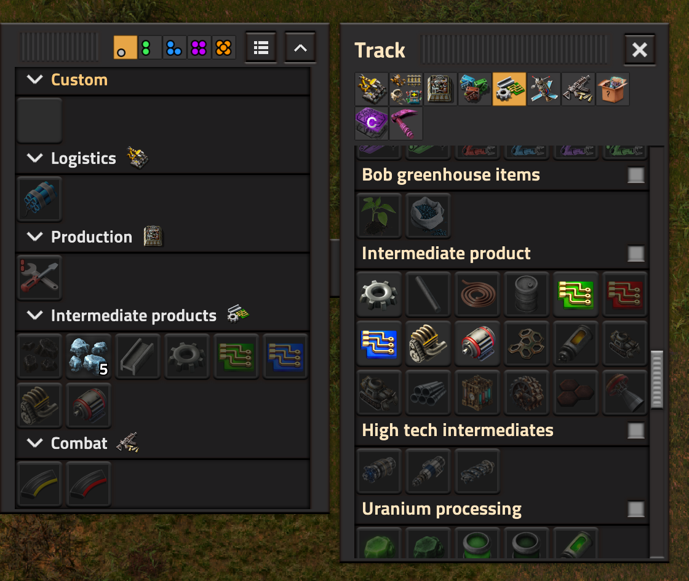
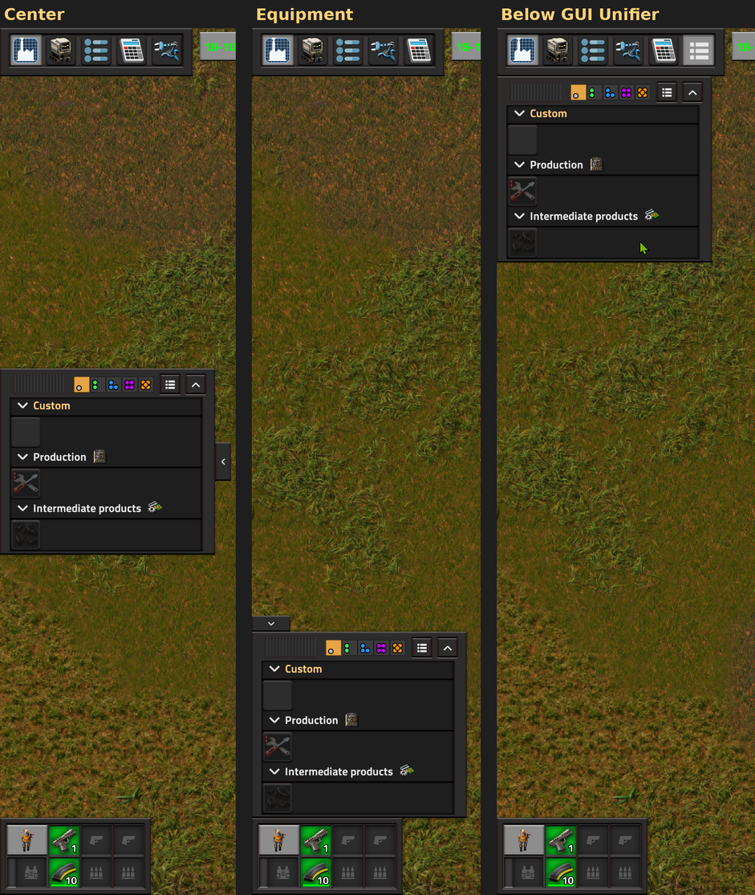

# Too Many Buildables - (TMB)

**Every building you own, one click away, without giving up your quickbar.**

Big mod packs add hundreds of buildings, and the quickbar was never meant to hold them all. TMB adds a collapsible panel that drops down **exactly over your quickbar**. It's sorted like the crafting menu and shows everything you can build, with live counts. On top of that you get a Materials side panel, a "How many?" crafting popup that works anywhere, and two build trackers: **Casper** for ghosts and **Ritual** for upgrades.

---

## Buildables panel

Click the **▾** tab above your quickbar to open the panel and **▴** to go back. Your quickbar stays as it is underneath.

- **Fits over the quickbar.** It matches your quickbar's size and position, follows your UI scale and resolution, and keeps its right edge flush with the shortcut bar. It also stays lined up in Remote View.
- **Every buildable in the game:** buildings, vehicles, tiles, rails, plant seeds and modules. Researched or not, every item keeps its place; anything you don't have is greyed out.
- **Crafting-menu categories,** one tab per item group, taken from the game itself. **Any mod list works**, including mods TMB has never heard of.
- **Live counts** that update as you build and pick things up.

**Click** an item to pick it up. If you have none, you get its **ghost** instead.

**Pipette (Q)** works on TMB's slots too: hover a slot and press your pipette key for the item, or its ghost if you have none.

**Craft straight from a slot:** Shift + click crafts one, Shift + right-click crafts five, Ctrl + Shift + click crafts as many as you can. Hover any slot to see its shortcuts.

### Make it yours

The **category tabs** can sit on the left, on top or on the right of the panel; the **slot layout** can be Rows, Compact, Columns or Dense; and items can be sorted in **crafting order** or **by type**. Open *Settings → Mod settings → Per player* to try them out.

---

## "How many?"

**Ctrl + click** an item, in TMB's panels or in the **vanilla crafting menu**, and a small popup asks how many to craft.

- Drag **Stacks** (whole stacks, 0 to 10) and **Singles** (up to one stack), or just type a number and press Enter.
- Follows your stack sizes, including mods that change them.
- Shows how many you have **on hand**, and your inventory stays open.

---

## Quality

- **Quality buttons** sit on the left of the panel. Pick a quality and the panel shows counts, badges and greyed slots for **that quality only**.
- Clicking picks up that quality; right-click ghosts it.
- The buttons only appear when the game has quality enabled. Modded qualities are supported.
- Hand-crafting always makes Normal quality, so crafting works on the **Normal** tab.

---

## Materials panel

A side panel for intermediates and crafting materials, collapsible like the toolbelt.

- **Custom bar:** pin any item you like (pipes, ammo, anything).
- **Track menu:** pick exactly which materials to show, item by item or a whole subgroup at once.
- Grouped by crafting-menu tab, with collapsible sections and its own quality buttons. Sorted by type or in crafting order (your choice).
- At most 10 rows tall, 6 to 9 slots wide (your choice); longer lists scroll.

**Four positions:** centred on the left edge, above the equipment panel, under **GUI Unifier** (offered only when it's installed), or anywhere you drag it.

---

## Casper and Ritual: build tracking (built in)

**Casper** tracks ghosts. Drag its tool over a build and every unbuilt ghost gets green brackets and a map mark, the area gets a green outline, and a bar at the top of the screen counts what's left. Ghosts tick off as they get built, and the bar disappears when the job is done.

**Ritual** is Casper for upgrades: drag it over buildings marked for upgrade and it tracks them in cyan, counted by what each building will become.

The video shows both in action:

- **Job area:** Shift-drag to grow the area into any shape, still one outline. New ghosts and upgrade orders placed inside it later are picked up too, whoever on your team places them.
- **Auto-track:** turn on the **Casper auto-track** shortcut and every blueprint you paste is tracked automatically: its ghosts in Casper, its upgrades in Ritual.
- **Guide arrow:** hover an item on the bar to point to the nearest one; click to keep pointing.
- **Craft from the bar:** click the ghost icon to **craft everything you're missing**, Shift + click an item to craft what you're missing of it, Ctrl + click for "How many?" with the shortfall already filled in.
- **Change type or quality:** right-click an item to swap all its ghosts at once, like an upgrade planner: pick a new type and quality, then Confirm. Ctrl + Z undoes it. Changed ghosts **move to Ritual** until they're built; undo moves them back.
- **Exorcist:** a companion tool to remove ghost types from the job.

Casper is also available on its own as **Casper: Ghost Tracking**. If both are installed, the standalone mod takes over and TMB's copy switches itself off.

### Ghost Project

When crafting for a job comes up short, the Materials panel gets a **Ghost Project** section listing every ingredient the job still needs that you don't have: plates, gears, circuits, pipes, other buildings, modded parts.

- The badge shows **how many you're missing**. The tooltip shows the total for every remaining craft, broken down per building.
- The missing slots **blink red** each time a craft fails because of them.
- If the Materials panel is closed, it opens for a few seconds to show you, then closes again.
- Items drop off once you have enough, and the section goes away when the job ends.

---

## Controls

**Buildables and Materials panels**

| Click | Action |
|---|---|
| **Click** | Pick up (ghost if you have none) |
| **Right-click** | Ghost in hand |
| **Q (pipette)** | Pick up, or ghost if you have none |
| **Shift + click** | Craft 1 |
| **Shift + right-click** | Craft 5 |
| **Ctrl + Shift + click** | Craft as many as possible |
| **Ctrl + click** | How many? |

**Casper and Ritual bars**

| Click | Action |
|---|---|
| **Click the tool icon** | Craft everything you're missing |
| **Right-click the tool icon** | Hide or show the list |
| **Hover / click an item** | Point to the nearest one / keep pointing |
| **Shift + click an item** | Craft what you're missing |
| **Ctrl + click an item** | How many? (pre-filled) |
| **Right-click an item** | Change type or quality |

- Every panel also lists its clicks in a tooltip, so you never have to remember them.
- Optional hotkeys for the panels, Ritual and auto-track are in Settings → Controls, **unbound by default**. Casper and the Exorcist have shortcut buttons and default keys (Shift + Alt + G / Shift + Alt + E).
- Bars taller than 2 rows scroll.

---

## Settings (per player)

| Setting | What it does |
|---|---|
| **Quickbar rows** | Match this to *Interface → Active quickbars* (the game doesn't let mods read it) |
| **Quickbar width** | **Auto** reads it from the game, or set it yourself |
| **Category tab position** | Left, Top or Right |
| **Slot layout** | Rows, Compact, Columns or Dense |
| **Buildables sort order** | Crafting order or By type |
| **Fine-tune offsets** | Nudge the panel a few pixels if your HUD is set up differently |
| **Materials panel width** | 6 to 9 slots per row |
| **Materials panel position** | Left edge, above equipment, under GUI Unifier, or free |
| **Materials sort order** | By type or Crafting order |

---

## Compatibility

- Factorio **2.1** (2.1.22 or newer). **Space Age is optional.**
- Built for big mod packs such as Bob's and Angel's: categories, sorting and icons all come from the game, with no per-mod lists.
- Multiplayer-safe: every setting, panel and tracker is per player.

---

## Credits & license

- Inspired by the ideas behind *Placeables* and *Toolbars*. **No code from either mod is used**; TMB is written from scratch.
- Licensed under **MIT**. Source: [GitHub](https://github.com/williamperry9694-cyber/Too-many-buildables-TMB)

*This mod was made with AI assistance (Claude by Anthropic).*
